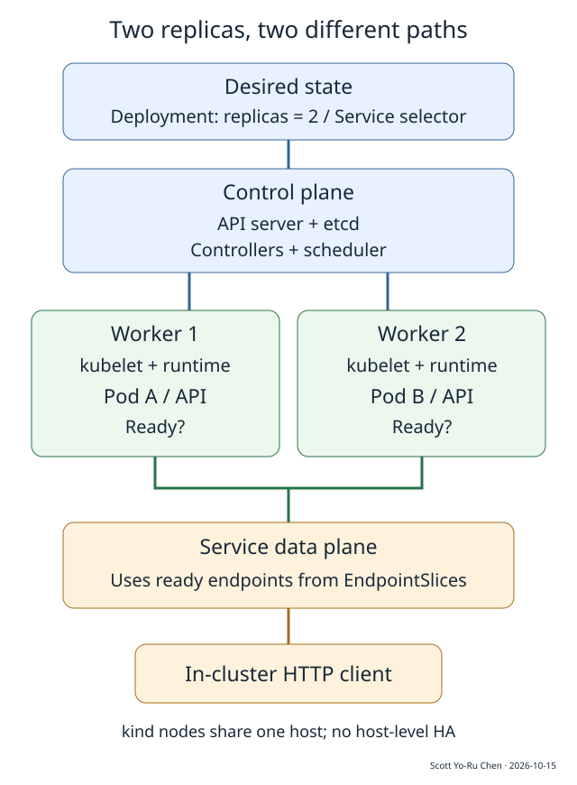
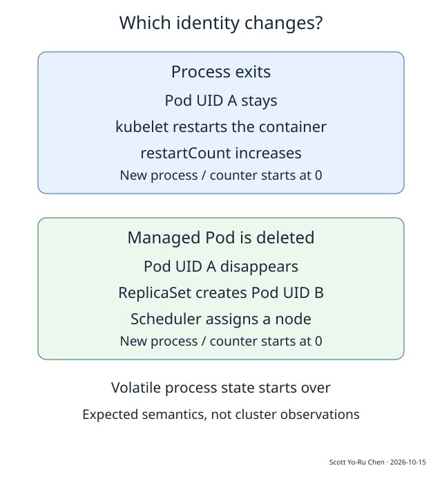

# K082 讓兩副本 API 持續運作需要哪些 Kubernetes 元件

課程 01；穩定 ID K082。先備是程序、TCP/IP 與基本作業系統觀念，Kubernetes 從這裡開始。教材包含完整系統模型、練習與待實跑的叢集程序；目前是 **blocked / experiment partial**，不是完成單元。已實跑項目與限制見 [runs](runs/20261015T1111Z/README.md)。

假設一個 API 原本由單一 Linux 程序提供服務。程序退出時，systemd 一類的 supervisor 可以重啟它；流量增加時，也可以再開一個程序並加上反向代理。當兩個實例分散在不同機器，新的工作開始出現：哪台機器還有資源、誰補上消失的實例、更新時先停誰、客戶端要連哪裡，以及啟動成功後究竟能否處理請求。

Kubernetes 以持續運作的控制元件管理這些變動。操作人員提交「要兩個 API 實例」的物件，系統反覆比較宣告與觀測，再建立或終止執行實例。應用程式繼續負責資料、交易與請求結果；叢集負責讓指定的工作負載在可用資源上執行。兩者配合，才有可用的服務。

下圖先看兩條路。上半部保存與調整「要什麼」；下半部是真正執行 API、承接請求的節點。一般 Service 流量由資料平面送往後端，API server 處理的則是管理操作。這個區分能解釋「管理 API 暫時不可用，但已在執行的程序仍可服務」的情境。

圖一：教學系統模型，依據 [Kubernetes Components](https://kubernetes.io/docs/concepts/overview/components/#core-components) 與 [Service](https://kubernetes.io/docs/concepts/services-networking/service/) 整理；同一實體主機上的 kind 節點是學習用拓樸，沒有跨主機容錯。

## 先分清程序、容器與 Pod

程序是 OS 排程執行的實體，帶有位址空間、檔案描述元等狀態。容器把程序放入受限制的執行環境，搭配映像提供檔案內容與啟動方式。Kubernetes 再以 Pod 描述一組共同排程、共享部分環境的容器；本單元每個 Pod 只放一個 API 容器，先保留最容易觀測的情況。[Pod 概念](https://kubernetes.io/docs/concepts/workloads/pods/)

Pod 有自己的名稱與 UID。名稱方便操作，UID 用來辨認特定物件的身分。容器程序重啟時，同一 Pod 內可以產生新的容器執行實例；若原 Pod 被刪除，接替它的 Pod 會有另一個 UID。後者也可能出現在其他節點。把這兩種情況都叫「服務重啟」，會漏掉資料、網路身分與排程上的差異。[Pod Lifecycle](https://kubernetes.io/docs/concepts/workloads/pods/pod-lifecycle/#pod-lifetime)

Pod 通常有可變的網路位址。客戶端若永久記住某一個 Pod 位址，替換實例後就需要重新找到它。因此對外使用穩定名稱的 Service，把後端集合的變動交給叢集追蹤。本單元採用 ClusterIP Service，僅供叢集內存取；沒有建立公開入口，也沒有讓本機直接連到 ClusterIP 的假設。

三個名詞形成最小模型：程序執行業務，Pod 是 Kubernetes 安排容器工作的單位，Service 提供存取一組後端的入口。接著還需要一個保存副本數及版本更新意圖的物件。

## Deployment 保存要維持的副本數與版本

Deployment 的 spec 描述兩件重要事情：希望同時有幾個副本，以及新 Pod 應使用的 template。template 裡有映像、連接埠、環境變數、探測方式與資源需求。本單元把 replicas 設為 2，應用版本先用 v1，後續以 v2 模擬更新。

Deployment controller 管理 ReplicaSet，ReplicaSet controller 再維持相符的 Pod 數量。ReplicaSet 可先理解成「某一份 Pod template 的副本管理者」：同一版本的副本由它追蹤；更新 template 時，Deployment 可以逐步增加新版本的 ReplicaSet，減少舊版本。具體控制細節在 K084 再展開。[Deployments](https://kubernetes.io/docs/concepts/workloads/controllers/deployment/#use-case)

物件間透過 owner reference 表達管理關係。label 是物件上的鍵值標記，selector 則是挑選符合標記物件的條件。本單元 Deployment 和 Service 都使用 app=k082-api，讓它們對準同一組 API Pods；本次先學會讀這個對應，下一單元 K083 再逐一操作 YAML、label 與 namespace。

namespace 是 API 物件的命名與管理範圍，讓本單元的工作負載集中在 k082-foundations。它方便清楚指定操作目標；安全隔離還涉及身分、權限、網路與節點設定。教材腳本額外使用專用 kubeconfig、固定 context、叢集 UID 核對，避免把故障指令送往陌生叢集。

當一個受管理 Pod 被正常刪除，ReplicaSet 會再建立替代 Pod。若直接建立沒有管理者的裸 Pod，刪除後便缺少這條補副本的路徑。這是服務型工作負載從 Deployment 開始的原因；它同時提供後續更新與回復 template 的管理結構。

## 從提交宣告追到節點程序

一次建立工作負載的概念路徑如下。kubectl 把物件送到 API server；API server 接受並保存經過檢查的物件。controller 觀測到 Deployment，建立 ReplicaSet 及 Pod 物件。scheduler 找到尚未指定節點的 Pod，依可用資源與排程條件選擇節點。該節點的 kubelet 觀測到分配給自己的 Pod，再透過容器 runtime 啟動容器。[元件職責](https://kubernetes.io/docs/concepts/overview/components/#core-components)

這些步驟分別由持續運作的元件完成，沒有單一同步函式保證 apply 回來時就能收到 HTTP 200。應用映像可能拉取失敗，資源可能不足，程序也可能成功啟動卻尚未準備好。操作人員要讀取 status、事件與請求結果，才能知道工作推進到哪裡。

本單元宣告每個 Pod request 100m CPU 與 32Mi 記憶體，limit 為 1 CPU 與 64Mi。request 是排程與資源配置的重要輸入；limit 由節點上的機制執行。這些數值是輕量教學 API 的配置，實際用量與尾延遲要另量測。把 request 設小只會改變資源宣告，並不會讓程序的需求跟著縮小。

兩個 Ready Pod 也可能同時位於一個節點。因此 manifest 額外宣告依節點主機名稱分散的 topology spread constraint，讓這個三節點教學叢集把副本分布納入可見的條件。它使用 DoNotSchedule，無法滿足時就等待；nodeTaintsPolicy 設為 Honor，計算分布時也考慮 Pod 是否容忍節點 taint，避免把無法接任務的控制平面節點當成空白分布位置。節點故障後，剩餘資源與分布條件仍可能影響新副本的安置。[Pod Topology Spread Constraints](https://kubernetes.io/docs/concepts/scheduling-eviction/topology-spread-constraints/)

## Service 追蹤後端，readiness 決定是否接新流量

Service 的 selector 選中 API Pods。叢集以 EndpointSlice 保存後端資訊，節點上的 Service 資料平面依這些資訊處理流量。本單元採 kind 預設網路配置，不自行選定或比較 eBPF、iptables 等不同資料平面；後續網路單元再沿封包深入。[Service 與 EndpointSlices](https://kubernetes.io/docs/concepts/services-networking/service/#endpointslices)

應用有兩個簡單探測入口。/healthz 表示程序仍能回應存活檢查；/readyz 表示這個實例現在願意承接服務。kubelet 定期執行探測，readiness 失敗時，Pod 的 Ready 狀態改變，再傳遞到後端資料。這條路徑有探測週期與傳播時間，已存在的連線也有自己的生命週期。[探測的用途](https://kubernetes.io/docs/tasks/configure-pod-container/configure-liveness-readiness-startup-probes/)

實驗把 readiness 關閉，但讓 /healthz 繼續回 200。預期結果是程序仍在、Pod 退出可用端點集合；這有助於區分「程序不存在」與「程序存在但目前無法服務」。如果只是暫時不願接新流量，應先從 readiness 的語義思考，避免讓重啟變成每種異常的唯一處理方法。

客戶端從某個教學 Pod 連線到 http://api:8080/id，DNS 解析 Service 名稱，資料平面把連線導向後端。使用 kubectl exec 啟動這個客戶端只是教學工具；exec 的管理連線會經過控制平面，而容器內 HTTP 請求走 Service 資料路徑。兩段流量的角色要分開。

測試程式每次回應帶 Connection: close，方便發起新的獨立連線。即使收集二十次請求，也只足以看到該環境的後端選擇樣本。嚴格輪流、公平性或長連線分布需要另外定義與驗證，不能只憑兩個 Pod 存在便假設。

## 四種故障會留下四種不同狀態

第一種是程序退出。實驗 API 的故障端點讓 PID 1 以 17 退出。kubelet 依 Deployment Pod 所使用的重啟政策，安排同一 Pod 內的替代容器。觀測時要同時保留 UID 與 restartCount：前者辨認 Pod，後者觀察容器重啟。應用的記憶體 counter 隨新程序從 0 開始。

第二種是刪除 Pod。正常刪除會啟動終止流程，管理者再建立另一個 Pod。比對前後 UID，可以看出這次替換的是 Pod 本身。新 Pod 需要再經過排程、容器啟動及 readiness，舊 Pod 的記憶體內容也沒有自動移交。

圖二：依據 [Pod lifetime](https://kubernetes.io/docs/concepts/workloads/pods/pod-lifecycle/#pod-lifetime) 整理的預期行為；圖內 A、B 是教學代號，非實際測量資料。

第三種是節點失聯。控制平面從心跳與節點狀態判斷異常，之後還涉及 taint、容忍時間、Pod 驅離與替代排程。這比刪除 Pod 多了故障偵測與不確定狀態；原節點上的程序在網路分割時可能仍然執行，因此外部寫入需要另處理重複執行風險。[Taints and Tolerations](https://kubernetes.io/docs/concepts/scheduling-eviction/taint-and-toleration/#taint-based-evictions)

本單元的節點演練只暫停自己建立的 worker 容器，再解除暫停。必須記錄實際延遲、Node Ready、原 Pod、替代 Pod 與端點變化，並把「暫停容器節點」和「實體主機故障」分開。三個 kind 節點共用一個主機，主機一旦離線會一起失效。

第四種是更新成一個始終無法通過 readiness 的版本。本單元 maxUnavailable=0、maxSurge=1，允許多建立一個副本，再等待它可用。當新版不 Ready，舊版在這套策略及容量條件下繼續承接服務，rollout status 則可能逾時。這個等待有助於阻止壞版本快速取代全部舊版，也會占用額外資源。[Rolling Update Deployment](https://kubernetes.io/docs/concepts/workloads/controllers/deployment/#rolling-update-deployment)

回復時使用 rollout undo 回到上一份 template，然後再次檢查版本、Ready、端點及實際 HTTP 回應。這個動作管理的是 Deployment 的修訂；資料庫 schema、外部付款與已送出的訊息要由應用設計相容性與補償。教材 counter 刻意留在記憶體，就是讓執行實例回來和業務資料回來之間的差異可以被看見。

## 兩副本能撐多少工作，要先算失去一個後的容量

假設算例：每個 API 副本在指定 SLO 下可承受 120 requests/s，正常流量為 180 requests/s。兩副本健康時總容量為 240 requests/s；若一個故障，剩餘處理量只有 120 requests/s，每秒少處理 60 個請求。若沒有排隊上限，十秒便可能多出 600 個等待請求，重試還會增加額外流量。

這些數字是教學假設，沒有用本次 HTTP 測試推估吞吐。單副本容量要在指定 CPU、記憶體、請求成本、並行量與延遲條件下測得。即使控制迴路最後補回兩副本，偵測、啟動與加入後端的等待期間，也可能早已發生大量逾時。

三副本在一個故障後，假設仍剩 240 requests/s，容量比兩副本更有餘裕；代價是平時預留更多資源。另一個選項是在容量下降時降低受理流量，以清楚的錯誤或重試政策維持已受理請求的品質。還可以改善單副本效率，但仍須重新量測服務時間與資源瓶頸。

更新也需要算容量。兩個正常副本加一個 surge Pod，宣告 CPU request 合計是 300m，記憶體 request 是 96Mi；若只替兩副本預留資源，更新可能因新 Pod 無處安置而等待。終止中的 Pod 在寬限期仍可能占用資源，這些合計只描述三個非終止副本的配置，並不是實際消耗的上限。

## 選擇叢集之前，先比較要長期承擔的工作

| 方案 | 適合的起點 | 需要自行負責的部分 | 引入的成本 |
| --- | --- | --- | --- |
| 單機 supervisor 加反向代理 | 主機數少，故障範圍可接受，部署變更簡單 | 主機故障後切換、副本配置、更新與發現 | 組件少，但跨主機操作容易累積成自製工具 |
| Docker Compose 或其他單機容器編排 | 想先固定映像、依賴與開發環境 | 跨機排程、機器失效時接替、服務入口 | 管理面較小，跨主機責任仍留給團隊 |
| Kubernetes Deployment 加 Service | 需要持續調整副本、跨節點配置與工作負載更新 | 應用資料、SLO、叢集容量與維運政策 | API／控制平面、網路及叢集生命週期都要有人管理 |

容器化和叢集化可以分開推進。團隊若只需讓一台固定主機的程序可靠啟動，採用 supervisor 可能更容易維護；若跨機器的補副本與版本更新已反覆發生，共用的宣告與控制模型才更有幫助。選型應回到實際工作量與維運責任，而不是用組件數量代表成熟度。

兩副本服務也還沒有完成整套應用。沒有外部入口、TLS、資料庫、備份、業務驗證、告警與流量保護，本單元刻意先留下這些後續問題。先能讀懂「哪個物件要兩個、哪個元件啟動程序、哪個集合承接流量」，再往 K083 的物件與 API 操作、K084 的生命週期、K085 的完整應用接線前進。

## 實驗、練習與完成條件

- [版本與環境](environment.md)：目標版本、尚待補齊的 runtime 與映像鎖定。
- [操作程序](runbook.md)：建立、正常請求、四類故障、觀測與清理。
- [練習](exercises/README.md) 與 [解答](solutions/README.md)：每一題的核對方式。
- [本次 raw run](runs/20261015T1111Z/README.md)：實際執行的測試與阻塞。
- 本單元公開長文尚未建立或發布；網站來源、build、deploy、正式正文及圖片均未驗證。

完成 K082 前，要在明確隔離的叢集實跑正常部署、容器退出、Pod 刪除、readiness、錯誤 rollout、節點失聯及清理，保存版本、指令、輸出、退出碼與時間線。接下來一次具備環境的執行，應先補這些觀測並修正教材，再走網站發布程序，才把 next_unit 移到 K083。

## 證據範圍

本次實際驗證 Python HTTP 行為、應用故障端點與 YAML／腳本的離線檢查。沒有 Kubernetes、容器 runtime、CNI 或 CSI 的實際執行紀錄，圖解與叢集預期輸出來自官方語義，與真實叢集觀測分開。CPU、吞吐與等待時間的數字明確標為假設算例，未用來宣稱效能改善。

kind v0.33.0 的節點映像鎖定取自官方 release；Python 基底映像 digest 尚未取得，因此容器建置仍阻塞。所有測試資源都以單元命名，故障端點只供專用隔離叢集；不得部署至公開或正式服務。

## 來源

- [Kubernetes Components](https://kubernetes.io/docs/concepts/overview/components/)
- [Pods](https://kubernetes.io/docs/concepts/workloads/pods/)
- [Pod Lifecycle](https://kubernetes.io/docs/concepts/workloads/pods/pod-lifecycle/)
- [Deployments](https://kubernetes.io/docs/concepts/workloads/controllers/deployment/)
- [Service](https://kubernetes.io/docs/concepts/services-networking/service/)
- [Probes](https://kubernetes.io/docs/tasks/configure-pod-container/configure-liveness-readiness-startup-probes/)
- [Topology Spread](https://kubernetes.io/docs/concepts/scheduling-eviction/topology-spread-constraints/)
- [Taints and Tolerations](https://kubernetes.io/docs/concepts/scheduling-eviction/taint-and-toleration/)
- [kind v0.33.0 release](https://github.com/kubernetes-sigs/kind/releases/tag/v0.33.0)

